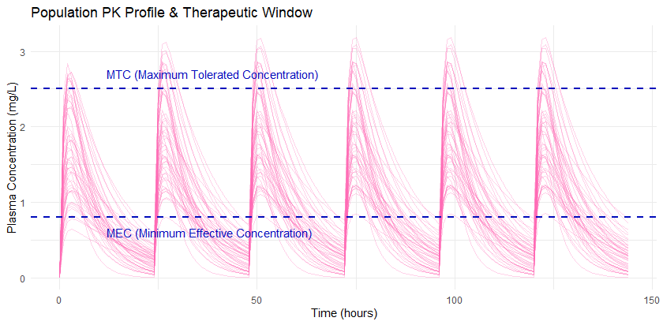
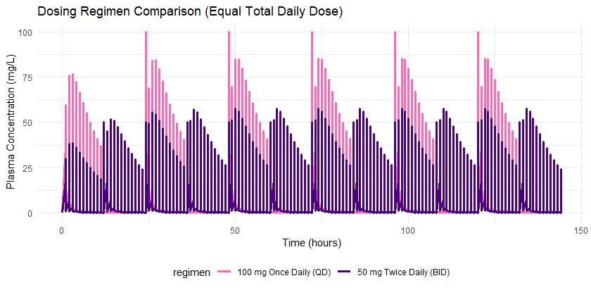
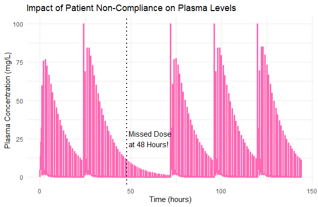
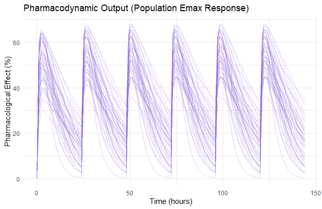

# Advanced Population PK/PD Simulation Project

An advanced, comprehensive pharmacometric simulation project built with the `PKPDsim` and `ggplot2` R packages. This repository showcases various clinical scenarios, including population variability, therapeutic windows, dosing optimization, patient non-compliance, and pharmacodynamic (PD) Emax modeling.

## Implemented Scenarios & Visualizations

### 1. Inter-Individual Variability & Therapeutic Window
A population simulation across a cohort of 50 virtual patients. The graph incorporates hypothetical clinical thresholds: the Minimum Effective Concentration (MEC) and the Maximum Tolerated Concentration (MTC). This allows for a quick visual assessment of the proportion of the population at risk of sub-therapeutic underdosing or toxic overdosing.

### 2. Dosing Regimen Optimization
A deterministic comparison of two regimens delivering the exact same total daily dose (100 mg/24h):
- **Regimen A:** 100 mg Once Daily (QD)
- **Regimen B:** 50 mg Twice Daily (BID)
The simulation demonstrates how splitting the dose stabilizes plasma levels, minimizes peak-to-trough fluctuations, and keeps the patient safely within a narrow therapeutic range.

### 3. Patient Non-Compliance (Missed Dose Simulation)
Simulates a real-world scenario where a patient adheres to a QD regimen on Days 1 and 2, completely misses the scheduled dose on Day 3 (48h), and resumes therapy on Day 4. The curve highlights the steep drop in plasma concentration below effective levels and shows how many subsequent doses are required to rebuild steady-state kinetics.

### 4. Pharmacodynamic (PD) Emax Response
An extension of the structural ODE matrix into the pharmacodynamic space. Using a classic non-linear sigmoidal $E_{max}$ model, this simulation translates individual plasma drug concentrations into a measurable pharmacological response (%) over time for the 50-patient cohort.

## Model & Parameter Specifications

- **Structural Model:** 1-Compartment Oral Absorption Model сompiled via C++ compiler flags in Rtools.
- **Fixed Parameters:** $CL = 5 \text{ L/h}$, $V = 50 \text{ L}$, $K_a = 1 \text{ h}^{-1}$, $E_{max} = 100\%$, $EC_{50} = 1.5 \text{ mg/L}$.
- **Random Effects (IIV):** Log-normal distribution applied to $CL$ (10%), $V$ (5%), and $K_a$ (20%).

