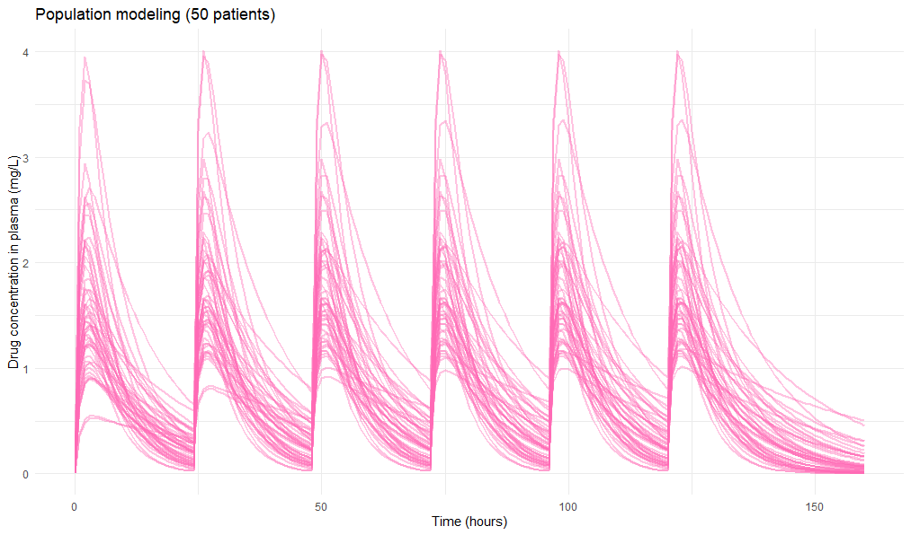

# Pharmacokinetic Modeling Using PKPDsim

This project demonstrates the simulation of multiple oral drug administrations using ordinary differential equations (ODEs) within the `PKPDsim` package.

## Model Description
A classic one-compartment pharmacokinetic model with first-order absorption (oral administration) is used.

## How to Run the Code
1. Ensure that the `PKPDsim` and `ggplot2` libraries are installed.
2. Run the script `simulation_project.R`.

## Simulation Results
The plot below shows the change in drug concentration in the blood plasma:
